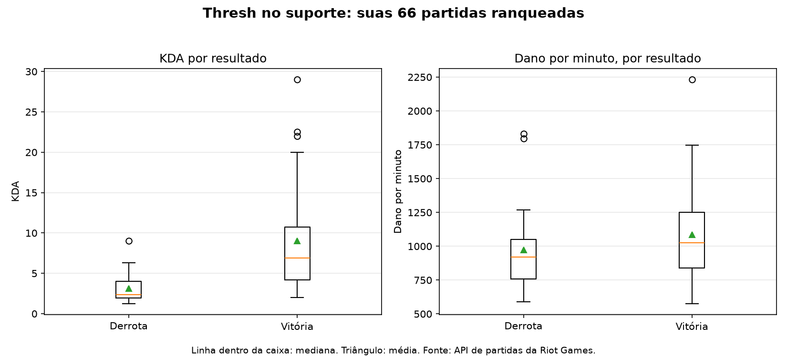

# Análise de Thresh no suporte (League of Legends)

[English](readme.en.md) | Português

Projeto de análise de partidas ranqueadas de League of Legends, usando a API oficial da Riot Games. A pergunta central é: o que diferencia as partidas vencidas e perdidas de um suporte, neste caso o Thresh?

> Este projeto não é endossado pela Riot Games. League of Legends e Riot Games são marcas registradas da Riot Games, Inc.

## Dados

- **Match-v5 (API da Riot):** histórico de partidas ranqueadas solo/duo (fila 420) e flex (fila 440), filtrado pelo PUUID de cada jogador, com o campeão Thresh na posição UTILITY.
- **Data Dragon:** informações públicas de campeões, usadas para a ficha de lore.

Os dados brutos ficam em `data/raw/` e não são versionados. Os dados processados e os gráficos ficam em `data/processed/`.

## Pipeline

1. **Coleta:** `src/historico_thresh.py` lista todo o histórico do jogador em blocos de 100 e baixa cada partida, respeitando o limite de taxa da API (20 requisições por segundo e 100 a cada 2 minutos). Cada partida é salva uma vez, em cache.
2. **Filtro:** `src/analise_thresh.py` seleciona só as partidas ranqueadas em que o jogador foi Thresh no suporte, identificando a linha pelo PUUID. Partidas com menos de 5 minutos (remakes ou abandonos) são excluídas.
3. **Indicadores:** KDA, ouro por minuto, dano por minuto, visão por minuto e duração.
4. **Intervalos:** `src/analise_intervalos.py` calcula intervalos de confiança de 95%, por bootstrap e pelo método de Wilson.
5. **Relatório:** tabelas de médias e medianas, por resultado, geradas em Markdown.
6. **Gráficos:** `src/graficos_thresh.py` gera os boxplots de KDA e dano por minuto.

## Métricas

- **KDA:** (abates + assistências) / mortes. Partidas sem mortes usam 1 como divisor, então o KDA passa a ser a soma de abates e assistências. Essa é uma convenção.
- **Ouro e dano por minuto:** a produção dividida pela duração da partida, para comparar partidas de tamanhos diferentes.
- **Visão por minuto:** a pontuação de visão dividida pela duração. A pontuação bruta cresce com o tempo, então não é comparável entre partidas longas e curtas.

Usei a **mediana** como medida principal, porque o KDA das vitórias tem valores extremos que puxam a média para cima.

## Resultados: suas partidas

Foram analisadas **60 partidas** de Thresh no suporte em ranqueada, com taxa de vitória de **53%**. Partidas com menos de 5 minutos (remakes ou abandonos) foram excluídas.

| Indicador | Derrota (média) | Derrota (mediana) | Vitória (média) | Vitória (mediana) |
|---|---|---|---|---|
| KDA | 3,15 | 2,37 | 9,01 | 6,88 |
| Ouro por minuto | 285,8 | 277,8 | 325,0 | 324,8 |
| Dano por minuto | 974,0 | 919,6 | 1 085,6 | 1 027,4 |
| Visão por minuto | 2,53 | 2,49 | 2,44 | 2,56 |
| Duração (min) | 32,9 | 34,6 | 28,2 | 29,5 |

**Intervalos de confiança (95%):**

- Taxa de vitória: 53% (faixa de Wilson: 41% a 65%).
- Mediana do KDA: 6,88 nas vitórias (4,75 a 9,50) e 2,37 nas derrotas (2,00 a 3,60).
- Diferença de medianas do KDA: +4,51 (2,17 a 7,10). O intervalo não inclui zero, então a diferença é consistente com os dados.
- Mediana do dano por minuto: 1 027 nas vitórias (918 a 1 186) e 920 nas derrotas (783 a 1 043). Os intervalos se sobrepõem, então a diferença não é conclusiva.



**Principais achados:**

- O KDA foi o indicador que mais separou vitórias de derrotas. A diferença entre as medianas é consistente com os dados.
- As três partidas de KDA mais alto foram vitórias. Uma delas terminou sem nenhuma morte.
- Ouro e dano por minuto ficaram próximos nas medianas, e as faixas de confiança se sobrepõem. Não há evidência de que esses indicadores separem vitórias de derrotas nestas partidas.
- A visão por minuto foi praticamente igual nos dois grupos.

## Comparação com um jogador de referência

Comparei o histórico de Thresh no suporte com o de um jogador de referência, com **34 partidas** no mesmo critério. Não é uma média do elo nem do Thresh: é uma comparação entre duas contas.

| Indicador | Você (derrota) | Referência (derrota) | Você (vitória) | Referência (vitória) |
|---|---|---|---|---|
| KDA (mediana) | 2,37 | 1,85 | 6,88 | 5,00 |
| Ouro por minuto (mediana) | 277,8 | 277,0 | 324,8 | 314,7 |
| Dano por minuto (mediana) | 919,6 | 687,7 | 1 027,4 | 863,2 |
| Visão por minuto (mediana) | 2,49 | 2,66 | 2,56 | 2,64 |

Taxa de vitória: 53% (sua conta) e 58,8% (referência). Com amostras desse tamanho, a diferença não é conclusiva.

A maior diferença aparente está no dano por minuto: cerca de 230 pontos acima na mediana das derrotas e 165 nas vitórias. Os intervalos de confiança dessa comparação ainda não foram calculados, então ela deve ser lida como descritiva. Isso pode refletir estilo de jogo, mas a comparação não permite afirmar a causa.

## Limitações

- **Amostra pequena:** 60 e 34 partidas são suficientes para medianas e intervalos, mas não para afirmar padrões do jogo ou da população.
- **Duas contas, não um padrão:** a comparação mostra diferenças entre dois jogadores, não entre o Thresh de um elo e outro.
- **Viés de jogador:** habilidade, estilo e time influenciam o resultado. A análise não separa esses fatores do efeito do campeão.
- **Associação, não causa:** as estatísticas se associam às vitórias, mas não explicam por que cada partida terminou como terminou.
- **Comparação com o top BR e o Esmeralda não concluída:** o Thresh no suporte é raro entre jogadores de elo alto. A coleta de 800 downloads encontrou só 5 partidas, insuficiente para comparação.
- **Visão bruta e KDA sem morte:** a pontuação de visão bruta depende da duração, e o KDA de partidas sem morte usa uma convenção.
- **Remakes:** o filtro de 5 minutos é um critério usual, mas pode excluir partidas curtas legítimas. Os números foram calculados com esse critério.

## Como rodar

```bash
pip install requests python-dotenv pandas tabulate numpy matplotlib
```

Crie um arquivo `.env` na raiz com sua chave:

```
RIOT_API_KEY=RGAPI-sua-chave
```

Depois rode, nesta ordem:

```bash
python src/historico_thresh.py
python src/analise_thresh.py
python src/analise_intervalos.py
python src/graficos_thresh.py
```

## Estrutura

```
src/                  scripts de coleta, análise e gráficos
data/raw/             partidas baixadas (não versionado)
data/processed/       CSVs, tabelas e gráficos gerados
```

## Lore do Thresh

Thresh é o Guardião das Correntes, um espectro das Ilhas das Sombras. Ele já protegeu segredos arcanos, até ser derrotado por forças que estão além da vida e da morte. Desde então, caça e acorrenta suas vítimas, e as almas que captura ficam presas na sua lanterna. Este resumo foi reescrito a partir da história oficial do campeão, disponível no site da Riot Games.