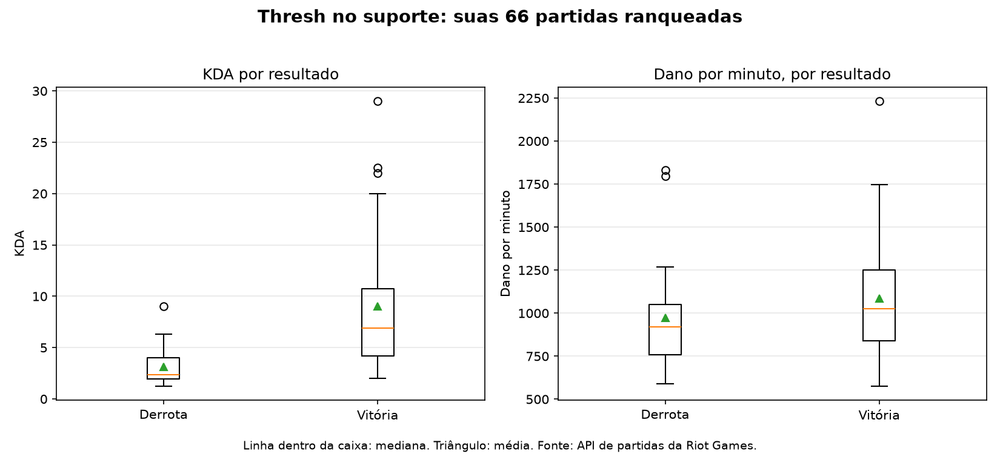

# Thresh in Support Role: A Personal Performance Analysis (League of Legends)

[Português](README.md) | English

An analysis of ranked League of Legends matches, built on the official Riot Games API. The central question: what separates winning and losing games for a support player, in this case Thresh?

> This project is not endorsed by Riot Games. League of Legends and Riot Games are trademarks or registered trademarks of Riot Games, Inc.

## Data

- **Match-v5 (Riot API):** ranked solo/duo (queue 420) and flex (queue 440) match history, filtered by each player's PUUID, with Thresh in the UTILITY role.
- **Data Dragon:** public champion data, used for the lore section.

Raw data is stored in `data/raw/` and is not versioned. Processed data and charts are stored in `data/processed/`.

## Pipeline

1. **Collection:** `src/historico_thresh.py` lists the player's full match history in pages of 100 and downloads each match, respecting the API rate limits (20 requests per second and 100 every 2 minutes). Each match is saved once, as a cache.
2. **Filtering:** `src/analise_thresh.py` keeps only the ranked matches in which the player was Thresh in support, identifying their row by PUUID. Matches shorter than 5 minutes (remakes or forfeits) are excluded.
3. **Metrics:** KDA, gold per minute, damage per minute, vision per minute, and match duration.
4. **Confidence intervals:** `src/analise_intervalos.py` computes 95% confidence intervals using bootstrap and the Wilson method.
5. **Reporting:** mean and median tables by outcome, generated in Markdown.
6. **Charts:** `src/graficos_thresh.py` generates boxplots for KDA and damage per minute.

## Metrics definitions

- **KDA:** (kills + assists) / deaths. Matches with zero deaths use 1 as the divisor, so the KDA equals kills plus assists. This is a convention.
- **Gold and damage per minute:** the total divided by match duration, so matches of different lengths can be compared.
- **Vision per minute:** the vision score divided by match duration. The raw vision score grows with time, so it is not comparable between long and short matches.

I use the **median** as the main measure, because the KDA in wins has extreme values that pull the mean upward.

## Results: my matches

I analyzed **60 ranked matches** with Thresh in support, with a win rate of **53%**. Matches shorter than 5 minutes (remakes or forfeits) were excluded.

| Indicator | Loss (mean) | Loss (median) | Win (mean) | Win (median) |
|---|---|---|---|---|
| KDA | 3.15 | 2.37 | 9.01 | 6.88 |
| Gold per minute | 285.8 | 277.8 | 325.0 | 324.8 |
| Damage per minute | 974.0 | 919.6 | 1,085.6 | 1,027.4 |
| Vision per minute | 2.53 | 2.49 | 2.44 | 2.56 |
| Duration (min) | 32.9 | 34.6 | 28.2 | 29.5 |

**95% confidence intervals:**

- Win rate: 53% (Wilson interval: 41% to 65%).
- KDA median: 6.88 in wins (4.75 to 9.50) and 2.37 in losses (2.00 to 3.60).
- Difference in KDA medians: +4.51 (2.17 to 7.10). The interval does not include zero, so the difference is consistent with the data.
- Damage per minute median: 1,027 in wins (918 to 1,186) and 920 in losses (783 to 1,043). The intervals overlap, so the difference is not conclusive.



**Main findings:**

- KDA was the indicator that best separated wins from losses. The difference between medians is consistent with the data.
- The three highest-KDA matches were wins. One of them ended with no deaths.
- Gold and damage per minute were close in the medians, and their confidence intervals overlap. There is no evidence that these indicators separate wins from losses in these matches.
- Vision per minute was practically the same in both groups.

## Comparison with a reference player

I compared my Thresh-in-support history with that of a reference player, with **34 matches** under the same criteria. This is not an average of an elo or of Thresh in general: it is a comparison between two accounts.

| Indicator | You (loss) | Reference (loss) | You (win) | Reference (win) |
|---|---|---|---|---|
| KDA (median) | 2.37 | 1.85 | 6.88 | 5.00 |
| Gold per minute (median) | 277.8 | 277.0 | 324.8 | 314.7 |
| Damage per minute (median) | 919.6 | 687.7 | 1,027.4 | 863.2 |
| Vision per minute (median) | 2.49 | 2.66 | 2.56 | 2.64 |

Win rate: 53% (my account) and 58.8% (reference). At these sample sizes, the difference is not conclusive.

The largest apparent difference is in damage per minute: about 230 points higher in the loss medians and 165 higher in the win medians. Confidence intervals for this comparison have not been calculated yet, so it should be read as descriptive. It may reflect playstyle, but the comparison does not establish a cause.

## Limitations

- **Small samples:** 60 and 34 matches are enough for medians and intervals, but not to establish patterns of the game or of a population.
- **Two accounts, not a pattern:** the comparison shows differences between two players, not between Thresh players of different elos.
- **Player effects:** skill, playstyle, and team composition influence results. The analysis cannot separate these from the effect of the champion.
- **Association, not causation:** the statistics are associated with wins, but do not explain why each match ended the way it did.
- **Comparison with top BR and Emerald not completed:** Thresh in support is rare among high-elo players. The 800-download collection found only 5 matches, which is not enough for a comparison.
- **Raw vision and zero-death KDA:** the raw vision score depends on duration, and the KDA of matches without deaths follows a convention.
- **Remakes:** the 5-minute filter is a common criterion, but it may exclude legitimate short matches. All numbers were calculated with this criterion.

## How to run

```bash
pip install requests python-dotenv pandas tabulate numpy matplotlib
```

Create a `.env` file in the root folder with your key:

```
RIOT_API_KEY=RGAPI-your-key
```

Then run, in this order:

```bash
python src/historico_thresh.py
python src/analise_thresh.py
python src/analise_intervalos.py
python src/graficos_thresh.py
```

## Structure

```
src/                  collection, analysis, and chart scripts
data/raw/             downloaded matches (not versioned)
data/processed/       generated CSVs, tables, and charts
```

## Thresh lore

Thresh is the Chain Warden, a wraith from the Shadow Isles. He once guarded arcane secrets until he fell to powers beyond life and death. Since then, he hunts and shackles his victims, and the souls he captures are trapped in his lantern. This summary was rewritten from the champion's official story, available on the Riot Games website.